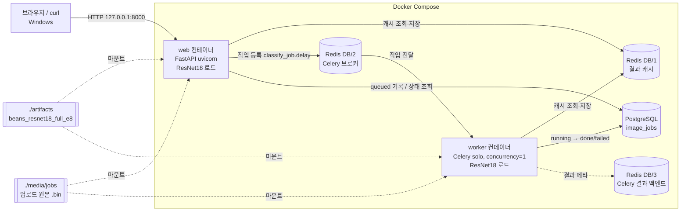

# 전체 시스템 아키텍처

- 실행 방식: **Docker Compose 4개 서비스** (redis · postgres · web · worker). 학습은 WSL2 `.venv` + GPU에서 별도 수행
- 진행 순서: ① WSL `.venv`에서 01 동기 API 확인 → ② 02 코드 작성 후 `docker compose up -d --build`로 web·worker까지 컨테이너 실행
- 서빙 모델: `artifacts/beans_resnet18_full_e8` (E4, Full Fine-tuning) — 호스트 폴더를 컨테이너에 마운트

## 1. 구성도

## 2. 구성요소 역할

| 컴포넌트 | 실행 위치 | 사용 파일 / 서비스 | 역할 |
|---|---|---|---|
| 브라우저 | Windows | `templates/sync.html`, `templates/async.html`, `base.html` | 파일 업로드·결과 표시 (비동기는 1초 간격 폴링) |
| FastAPI | Docker `web` (Python 3.11, CPU torch) | `main.py`, `ai/router_sync.py`, `ai/router_async.py`, `ai/router_web.py` | HTTP 요청·이미지 검증·응답, 시작 시 `init_db()` |
| ResNet18 | `web`, `worker` 각 프로세스에 **따로** 로드 | `ai/hf_model.py`, `ai/services.py` | 3클래스 분류 (`pipeline`, CPU `device=-1`) |
| Redis Cache | Docker `redis` DB/1 | `ai/cache_service.py` | 같은 이미지 결과 600초 재사용 |
| Redis Broker | Docker `redis` DB/2 | `ai/celery_app.py` | Celery 작업 전달 |
| Redis Backend | Docker `redis` DB/3 | `ai/celery_app.py` | Celery 작업 결과 메타 |
| PostgreSQL | Docker `postgres` (17-alpine) | `ai/database.py`, `ai/models.py` | 비동기 작업 상태·예측값 저장 |
| Celery Worker | Docker `worker` | `ai/tasks.py` | 비동기 추론·DB 갱신 |
| 작업 목록 (추가) | Docker `web` | `ai/router_jobs.py`, `templates/jobs.html` | PostgreSQL `image_jobs` 최신순 조회 → 표 화면 (3초 자동 갱신) |
| 결과 화면 (추가) | 브라우저 | `static/result.js`, `static/result.css` | 응답 JSON을 카드로 표시, 확신도 0.9 미만 "확인 필요" |
| 업로드 저장소 | 호스트 `./media/jobs` 마운트 | `router_async.py` | 비동기 원본 이미지 (`uuid.bin`, 사용자 파일명 미사용) |

## 3. 실행 환경

| 항목 | 값 |
|---|---|
| OS | Windows + WSL2 (커널 6.18 microsoft-standard-WSL2) |
| 학습 환경 | WSL2 `.venv` Python 3.14, torch 2.15.0+cu132, CUDA GPU |
| 서빙 환경 | Docker 이미지 Python 3.11, CPU-only PyTorch |
| Docker 서비스 | redis:7.4-alpine, postgres:17-alpine, web, worker |
| 포트 | 8000(web), 6379(redis), 5432(postgres) — 모두 `127.0.0.1`에만 공개 |
| Worker | `--pool=solo --concurrency=1` |
| 모델 경로 | `.env` `MODEL_PATH=artifacts/beans_resnet18_full_e8` |

## 4. 데이터 흐름 요약

- 동기: 브라우저 → FastAPI → Redis Cache(HIT면 바로 반환 / MISS면) → ResNet18 → Redis 저장 → 브라우저
- 비동기: 브라우저 → FastAPI(이미지 검증·파일 저장·`queued` 기록) → Redis Broker → Worker(`running` → 캐시/ResNet18 → `done`) → 브라우저가 `/api/async/jobs/{id}/` 조회
- 작업 목록 (추가): 브라우저 `/vision/jobs/` → 3초마다 `GET /api/async/jobs/?limit=20` → FastAPI → PostgreSQL `SELECT … ORDER BY id DESC` → 표
- 동기 결과는 `image_jobs`에 저장하지 않음 (DB에는 비동기 작업만 기록)
- Redis 캐시는 동기·비동기가 **공유** → 같은 사진을 동기로 먼저 보내면 비동기 작업은 `cache_hit=true` (실측: job 4~6)

## 5. 주의 사항

- Docker 안 주소는 서비스명(`redis`, `postgres`), 호스트(WSL·DBeaver)에서는 `127.0.0.1`
- 모델을 바꿀 때: `.env` 수정 → `docker compose up -d --force-recreate web worker` → Redis 캐시 DB/1 비우기 (실제 경험: 04 E-01 참고)
- 종료는 `docker compose stop` (볼륨 보존). `down -v`는 DB 데이터를 지우므로 사용 금지

## 6. 제공 코드 외 추가한 부분과 이유

| 추가 | 이유 | 기존 코드 영향 |
|---|---|---|
| 작업 목록 화면 `/vision/jobs/` + API `GET /api/async/jobs/?limit=` | 제공 코드는 job **1개**를 번호로 조회하는 API(`/api/async/jobs/{job_id}/`)만 있어, 쌓인 작업 전체는 psql·DBeaver로만 확인 가능했음 → 브라우저에서 상태·결과·캐시·확신도를 한눈에 확인 | 새 파일 `ai/router_jobs.py` 추가, `main.py`에 `include_router` 1줄, `base.html` 메뉴 1개 |
| 결과 카드 UI (`result.js`·`result.css`) | 원본 화면은 JSON 원문만 출력 → 한글 병명·확신도 막대·캐시 배지로 표시, **확신도 0.9 미만은 "사람 확인 필요"** (06 성능 향상의 R1 규칙을 화면에 연결) | API 응답 형식 변경 없음, 원본 JSON은 "원본 JSON 보기"로 유지 |
| 버튼·메뉴 스타일 | 화면 가독성 (색상 팔레트는 원본 유지) | `style.css` 끝에 추가만 함 |

- 원래 주소(`/health`, `/vision/sync/`, `/vision/async/`, `/docs`, `/api/sync/classify/`, `/api/async/classify/`, `/api/async/jobs/{job_id}/`)는 모두 그대로 동작
