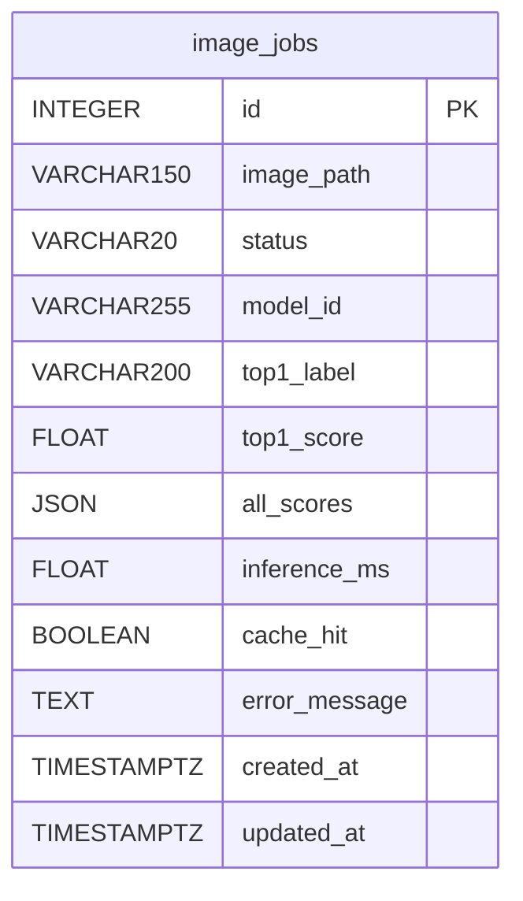
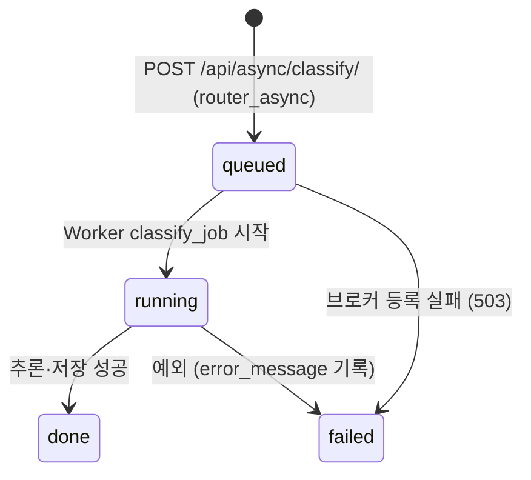

# 데이터베이스 구조 및 작업이력

- DBMS: PostgreSQL 17 (Docker `postgres`, DB `vision_db`, 사용자 `vision_user`)
- ORM: SQLAlchemy 2 (`ai/database.py`, `ai/models.py`) · 테이블 생성: FastAPI 시작 시 `init_db()` → `create_all`
- 테이블 1개: `image_jobs` (FK·관계 테이블 없음) · **비동기 작업만 저장** (동기 결과는 저장 안 함)

## 1. ERD



## 2. 컬럼 정의 (제공 코드 기준)

| 컬럼 | DB 자료형 | Nullable / 기본 | 실제 예시 값 | 사용 이유 |
|---|---|---|---|---|
| id | INTEGER | PK | 7 | 고유 작업번호 (`job_id`) |
| image_path | VARCHAR(150) | 필수 | `<uuid>.bin` | `media/jobs/` 안 원본 파일 찾기 |
| status | VARCHAR(20) | 기본 `queued`, 인덱스 | `done` | 처리 상태 |
| model_id | VARCHAR(255) | 기본 빈 문자열 | `artifacts/beans_resnet18_full_e8` | 어떤 모델로 처리했는지 |
| top1_label | VARCHAR(200) | NULL | `bean_rust` | 최종 분류 라벨 |
| top1_score | FLOAT | NULL | 0.9996 | 분류 점수 |
| all_scores | JSON | NULL | `[{"label":"bean_rust","score":0.9996}, ...]` | 3클래스 점수 |
| inference_ms | FLOAT | NULL | 2207.17 | 실제 추론 시간 (HIT면 NULL) |
| cache_hit | BOOLEAN | NULL | false | 캐시 재사용 여부 |
| error_message | TEXT | NULL | NULL | 실패 원인 (최대 1,500자) |
| created_at | TIMESTAMPTZ | 기본 UTC 현재시각 | [캡처 값] | 접수 시점 |
| updated_at | TIMESTAMPTZ | 기본 UTC, 수정 시 갱신 | [캡처 값] | 마지막 상태 변경 시점 |

## 3. 상태 전이



## 4. 실제 작업 이력 (조회 SQL)

```sql
SELECT id, status, model_id, top1_label, cache_hit, inference_ms
FROM image_jobs ORDER BY id DESC LIMIT 20;
```

| id | status | model_id | top1_label | cache_hit | 판정 |
|---:|---|---|---|---|---|
| 14 | done | full_e8 | healthy (0.669) | false | Worker 정지 중 접수 → `queued` 유지 → Worker 재시작 후 `done` (T-10) |
| 9~13 | done | full_e8 | (측정용) | false | 처리시간 측정 5회 (06 보고서) |
| 8 | done | full_e8 | (측정용) | false | 측정 warm-up (비교 제외) |
| 7 | done | full_e8 | bean_rust | false | 새 사진, Worker가 직접 추론 (MISS) |
| 4~6 | done | full_e8 | ALS / rust / healthy | **true** | 동기로 먼저 보낸 같은 사진 → 캐시 재사용 |
| 1~3 | done | **beans_resnet18** | ALS / rust / healthy | true | 모델 경로 전환 **전** 기록 (E0 기준선으로 서빙됨, 07 E-01) — 삭제하지 않고 보존 |

- `failed` 행: **미발생** (실험 중 실제 실패 작업 없음. 실패 경로는 모의 테스트 `test_worker_failure_records_failed`로만 확인)
- 증빙: `evidence/database.png` (DBeaver Data 탭), `evidence/erd.png`, psql 결과 캡처

## 5. 확인 도구

- psql: `docker compose exec postgres psql -U vision_user -d vision_db -c "..."`
- DBeaver: Host `127.0.0.1`, Port `5432`, DB `vision_db`, User `vision_user`
