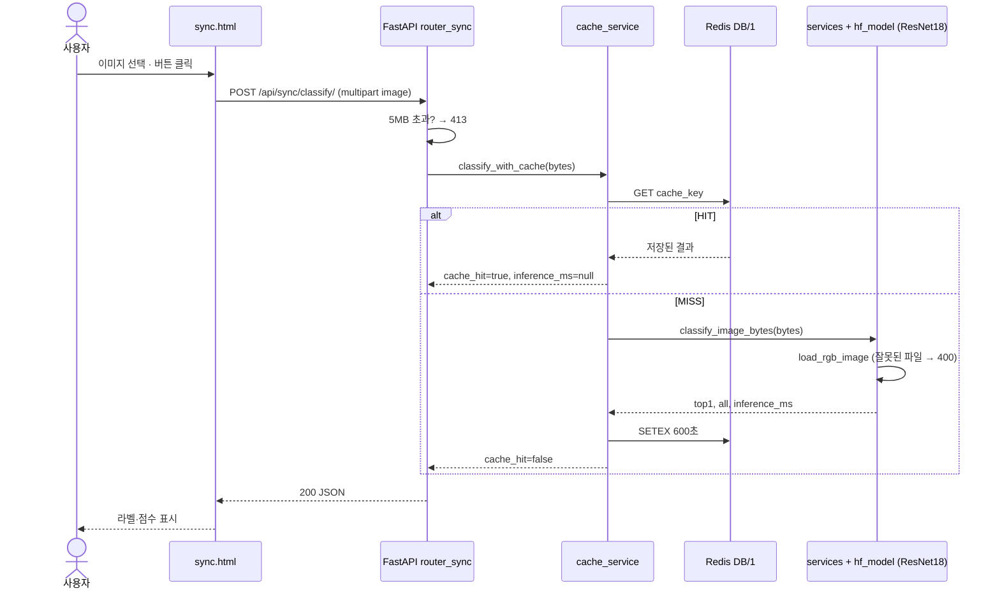
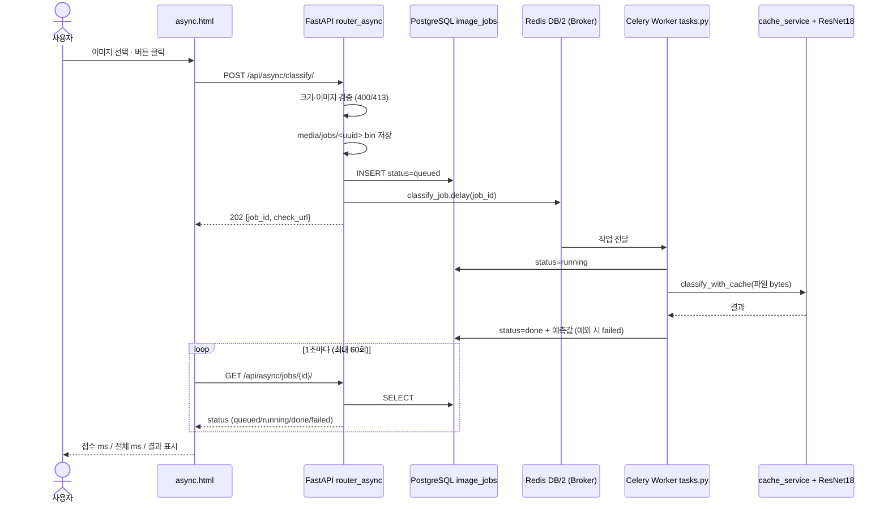
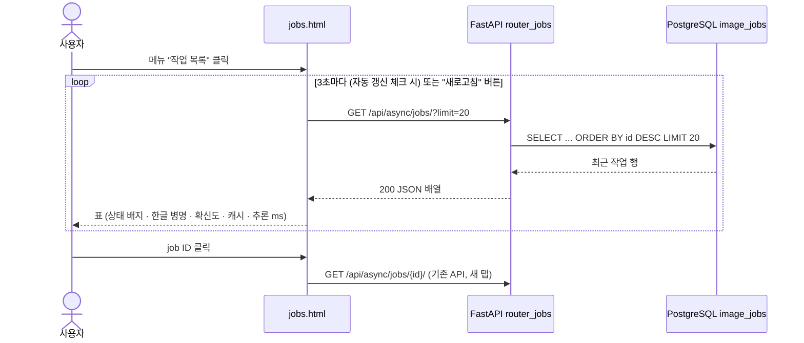

# AI 분석 버튼 처리 흐름

## 1. 동기 (`/vision/sync/` → "분석" 버튼)

## 2. 비동기 (`/vision/async/` → "Celery 작업 등록" 버튼)

## 3. 단계별 코드 대응표

| 단계 | 시작 파일 | 핵심 함수·처리 | 반환 / 다음 단계 |
|---|---|---|---|
| 동기 1 | `templates/sync.html` | `fetch()` | `POST /api/sync/classify/` |
| 동기 2 | `ai/router_sync.py` | `classify_sync()` | 크기 검사 → `classify_with_cache()` |
| 동기 3 | `ai/cache_service.py` | `classify_with_cache()` | HIT 반환 또는 `classify_image_bytes()` |
| 동기 4 | `ai/services.py` / `ai/hf_model.py` | `load_rgb_image()` · 분류기 호출 | `top1`, `all`, `inference_ms` |
| 비동기 1 | `templates/async.html` | `fetch()` POST | `202 / job_id` |
| 비동기 2 | `ai/router_async.py` | `enqueue_classify()` | 검증 · 파일 저장 · DB `queued` · `delay()` |
| 비동기 3 | `ai/tasks.py` | `classify_job()` | DB `running` → `done` / `failed` |
| 비동기 4 | `ai/router_async.py` | `get_job()` | 상태·예측 JSON (없으면 404) |
| 비동기 5 | `templates/async.html` | 1초 폴링 루프 | done/failed면 종료, "조회 중지"는 조회만 멈춤 |

## 4. 작업 목록 화면 (추가 기능, `/vision/jobs/`)

| 단계 | 파일 | 핵심 함수·처리 | 반환 |
|---|---|---|---|
| 목록 1 | `templates/jobs.html` | `load()` + `setInterval(3000)` | `GET /api/async/jobs/?limit=` |
| 목록 2 | `ai/router_jobs.py` | `list_jobs(limit)` | `select(ImageJob).order_by(id.desc()).limit()` 결과 배열 |
| 목록 3 | `static/result.js` | `LABEL_KO`, `REVIEW_SCORE=0.9`, `pct()` 재사용 | 0.9 미만 행 노란색 + "확인 필요" |

- 작업 목록은 **조회만** 함 (DB 쓰기·추론 없음) → Worker·Redis 부하 없음
- 결과 카드: 동기·비동기 화면 모두 응답을 받은 뒤 `renderResult()`로 카드 표시 (API 호출 순서는 위 1~3절과 같음)

## 5. 차이 요약

- 동기: 응답 안에 추론 결과가 포함됨 (요청이 추론 끝까지 기다림)
- 비동기: 202로 먼저 접수 → 결과는 별도 조회
- 두 경로 모두 **같은 ResNet18 모델 + 같은 Redis 캐시** 사용
