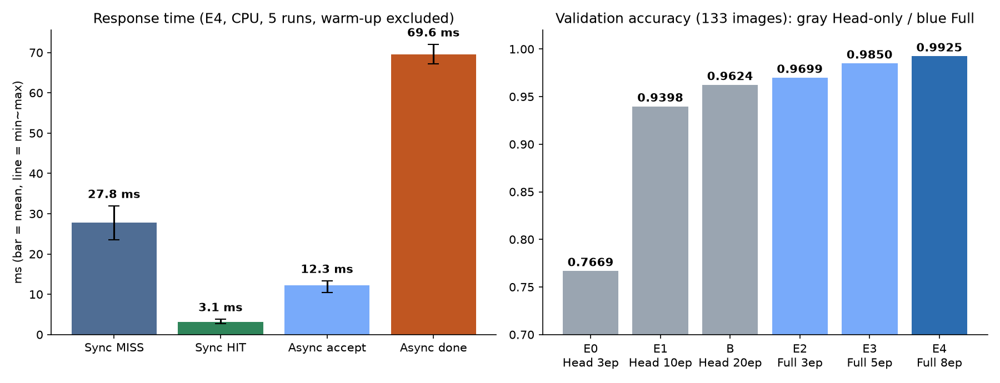
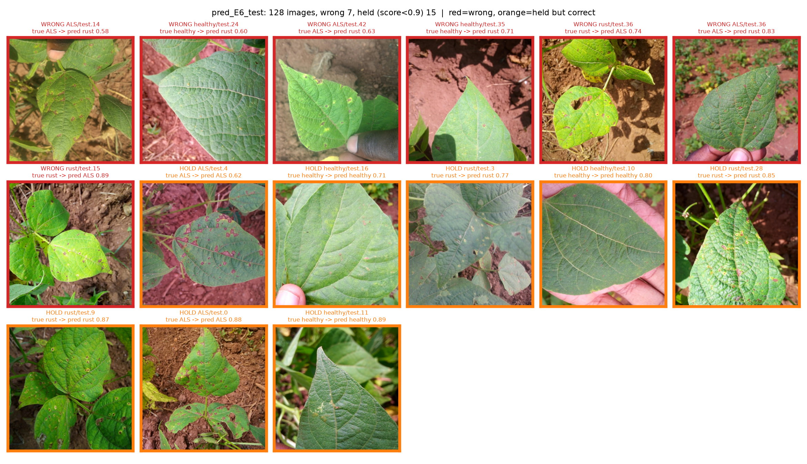
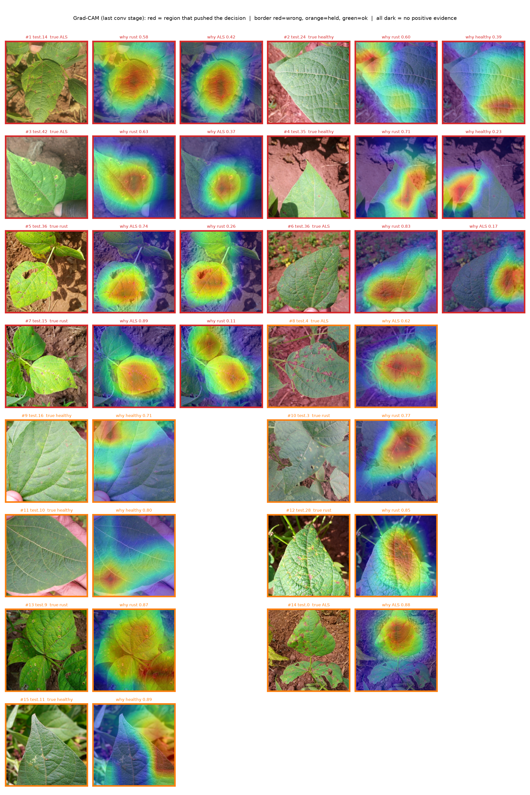

# 성능 측정 및 비교 보고서

이 보고서는 서로 다른 두 종류의 성능을 **따로** 다룬다.

- **Part A. 서비스 처리 시간**: 동기·비동기·캐시 경로의 응답 시간(ms)
- **Part B. 모델 분류 성능**: Fine-tuning 방식별 정확도와 성능 향상 실험 (평가가이드 6장)

비동기 접수 시간과 모델 Accuracy는 서로 다른 지표이며 섞어서 비교하지 않는다.

> 2026-11-04 서빙 모델을 E4(`beans_resnet18_full_e8`)에서 **E6(`beans_resnet18_aug_e15`, 증강 학습)**로 교체했다 (06 B-9). Part A 시간 측정과 B-1~B-6은 **E4 서빙 당시 기록**이다. E4와 E6는 같은 ResNet-18 구조이고 서빙 코드는 바뀌지 않았다.

---

## Part A. 서비스 처리 시간

### A-1. 실험 조건

| 조건 | 값 |
|---|---|
| 측정 도구 | `analysis/measure_timings.py` (httpx, `time.perf_counter`) |
| 이미지 | `dataset/test` 정렬 순서에서 앞 10장 건너뛰고 선택 → 결과적으로 **모두 angular_leaf_spot** (동기 test.2·20~23, 비동기 test.24~28). 500×500 동일 해상도, MISS는 매 회 다른 새 사진 |
| 모델 | `artifacts/beans_resnet18_full_e8` (E4, 측정 당시 서빙 모델. E6도 같은 ResNet-18 구조라 재측정하지 않음) |
| 실행 환경 | Docker web·worker 컨테이너, **CPU 추론** (`device=-1`), WSL2 메모리 15GiB, CPU 20 논리 코어 (`nproc`) |
| 반복 | 조건별 5회 |
| 캐시 | MISS(새 사진)와 HIT(방금 보낸 같은 사진)를 따로 측정 |
| Worker | `--pool=solo --concurrency=1` |
| 워밍업 | 동기 1회 + 비동기 1회 먼저 보내고 기록에서 제외 (모델 첫 로딩 제외) |
| 비동기 완료 시간 | 접수 요청 시작 → 50ms 간격 상태 조회로 `done`을 확인한 시점까지 (**폴링 포함**) |
| 측정 조건 | 학습 등 다른 무거운 작업이 없을 때 측정 |

### A-2. 원본 측정표 (ms, `data/timings.csv`)

| 반복 | 동기 MISS | 동기 HIT | 비동기 접수 | 비동기 완료 (MISS) |
|---:|---:|---:|---:|---:|
| 1 | 25.6 | 2.7 | 12.3 | 71.0 |
| 2 | 27.4 | 3.8 | 13.3 | 72.0 |
| 3 | 31.9 | 3.3 | 13.0 | 69.6 |
| 4 | 30.4 | 3.1 | 12.3 | 68.1 |
| 5 | 23.5 | 2.8 | 10.4 | 67.2 |
| 중앙값 | 27.4 | 3.1 | 12.3 | 69.6 |
| **평균** | **27.8** | **3.1** | **12.3** | **69.6** |
| 최소 ~ 최대 | 23.5 ~ 31.9 | 2.7 ~ 3.8 | 10.4 ~ 13.3 | 67.2 ~ 72.0 |

### A-3. 경로별 비교

| 경로 | 캐시 | HTTP 응답 (평균 ms) | 모델 추론 (`inference_ms`) | 메모 |
|---|---|---:|---:|---|
| 동기 | MISS | 27.8 | 18.4 ~ 26.1 (평균 21.9) | 모델 실제 추론 |
| 동기 | HIT | **3.1** | null | 추론 생략, Redis 값 반환 |
| 비동기 | MISS | 12.3 (접수) / 69.6 (완료) | 18.6 ~ 23.7 (평균 20.5) | 접수와 처리 분리 |
| 비동기 | HIT | 미측정 (접수) | null | 실제 사례: job 4~6 (동기로 먼저 보낸 사진) |
| (참고) 첫 요청 | MISS | 약 2,100~2,900 | 2,144 ~ 2,865 | web·worker 각각 모델 첫 로딩 (cold start), 비교에서 제외 |

### A-4. 해석

- **캐시 효과**: 동기 HIT 3.1ms는 MISS 27.8ms보다 약 **89% 짧다** (약 9배). 같은 사진·같은 모델이면 추론을 생략한다. 캐시 키 = 이미지 sha256 + 모델 경로 해시
- **비동기 접수**: 12.3ms로 동기 MISS(27.8ms)보다 약 **56% 빨리** 응답한다. 이는 **모델이 빨라진 것이 아니라**, 추론을 기다리지 않고 job 번호만 먼저 돌려주기 때문이다
- **비동기 완료**: 69.6ms로 동기보다 약 42ms 느리다. 큐 전달(Redis), DB 기록 3회(queued → running → done), 상태 조회(폴링)가 더해지기 때문이다
- **결론**: 이 모델은 CPU 추론이 약 20ms로 짧아서, 사진 1장만 놓고 보면 **동기가 더 빠르다**. 비동기의 장점은 속도가 아니라 **웹 서버가 추론을 기다리며 막히지 않는 것**이다. 추론이 무겁거나 요청이 몰릴 때 효과가 있다. 이번 측정에는 동시 요청 부하 테스트가 없어 그 효과는 **미측정**이다

### A-5. 점검

- [x] 같은 모델 체크포인트(E4)로 측정
- [x] MISS 대 MISS, HIT 대 HIT 구분
- [x] 같은 해상도(500×500)·같은 하드웨어
- [x] 모델 첫 로딩(warm-up)을 비교에서 제외하고 따로 기록
- [ ] 동시 요청 부하 측정: 미실시

---

## Part B. 모델 분류 성능과 성능 향상 실험

평가가이드 6장의 권장 순서 `① Head-only 기준선 → ② 전체 미세조정 비교 → ③ HSV/ROI/Mask 오분류 원인 분석 → ④ 규칙 기반 보류 → ⑤ 필요 시 ML 융합`을 따랐다.

**공통 규칙**
- 학습 코드 `training/finetune.py`는 수정하지 않고 실행 옵션만 바꿈. 실험마다 출력 폴더를 분리함
- 비교와 선택은 모두 **같은 Val 133장**으로만 함
- Test 128장은 최종 방법을 정한 뒤 **1번만** 확인 (`--confirm-test` 옵션이 없으면 실행되지 않게 막아 둠)
- **모델 단독 성능과 후처리(보류 규칙)를 붙인 시스템 성능을 따로** 보고함

### B-1. ① Head-only 기준선 vs ② Full Fine-tuning

| ID | 방식 | epochs | lr | Best Val Acc | 정답 / 133 | 출력 폴더 |
|---|---|---:|---:|---:|---:|---|
| E0 | Head-only (필수) | 3 | 2e-4 | 0.7669 | 102 | `beans_resnet18` |
| E1 | Head-only | 10 | 1e-3 | 0.9398 | 125 | `beans_resnet18_head_e10` |
| B | Head-only | 20 | 1e-3 | 0.9624 | 128 | `beans_resnet18_head_e20` |
| E2 | Full | 3 | 5e-5 | 0.9699 | 129 | `beans_resnet18_full_e3` |
| E3 | Full | 5 | 1e-4 | 0.9850 | 131 | `beans_resnet18_full_e5` |
| **E4** | **Full** | **8** | **5e-5** | **0.9925** | **132** | **`beans_resnet18_full_e8`** |

- 기준선 E0 → 최종 E4: 0.7669 → 0.9925 = **22.6%p 상승** (102장 → 132장)
- Head-only를 20 epoch까지 늘려도 0.9624에 머묾 → Full과 **3.0%p** 차이. ImageNet에서 가져온 특징을 고정하면 콩잎 반점 구분에 한계가 있음
- **재현성**: E4 설정을 4번 실행(E4·rerun·r3·r4)했더니 4번 모두 best 0.9925. 같은 seed 42여도 GPU 연산 때문에 epoch별 값은 조금씩 다름 (E4 1~3 epoch .9699/.9624/.9624, E2 .9173/.9699/.9323)
- **천장 효과**: Val 1장 = 0.75%p. E4는 오답이 1장뿐이라 더 좋은 설정이 있어도 Val로는 차이를 재기 어려움

**혼동행렬 (Val, 행 = 정답 / 열 = 예측: ALS · rust · healthy)**

| 정답 \ 예측 | E0 ALS | E0 rust | E0 healthy | E4 ALS | E4 rust | E4 healthy |
|---|---:|---:|---:|---:|---:|---:|
| angular_leaf_spot | 33 | 8 | 3 | 44 | 0 | 0 |
| bean_rust | 8 | 29 | 8 | 0 | 44 | **1** |
| healthy | 1 | 3 | 40 | 0 | 0 | 44 |

- E0는 병든 잎 두 종류(ALS↔rust)를 서로 헷갈리고, 평균 확신도도 0.58로 낮음
- E4의 유일한 오답: `bean_rust_val.8.jpg` → healthy (0.814). E0는 이 사진을 맞혔음

### B-2. ③ OpenCV HSV/ROI/Mask 오분류 원인 분석 (구현·측정함)

`analysis/hsv_lesion.py`: CNN 예측은 바꾸지 않고, 사진마다 잎 안 반점 면적비를 계산했다.

| 단계 | 방법 (교과9 기법) |
|---|---|
| 1. 잎 ROI | 초록 픽셀을 시작점으로 **GrabCut** → 가장 큰 덩어리 → 구멍 채움(Contour) → 가장자리 7×7 침식 |
| 2. 반점 후보 | **HSV**에서 잎 안의 "초록이 아닌" 픽셀 (H 27~90·S≥30 제외), V 30~220 |
| 3. 잡음 제거 | **Morphology Opening** 3×3 |
| 4. 반점 모양 | **Contour/연결요소** 면적 4~1500, 가로세로비 ≤ 2.5, 채움비 ≥ 0.35 |
| 5. 지표 | lesion_ratio = 반점 픽셀 / 잎 픽셀 |

| lesion_ratio 중앙값 | ALS | rust | healthy |
|---|---:|---:|---:|
| Train (1,034장) | 0.0318 | 0.0164 | 0.0008 |
| Test (128장) | 0.0363 | 0.0128 | 0.0022 |

- 중앙값으로는 병든 잎과 정상 잎이 잘 갈림. 하지만 **분포 끝은 겹침** (Train healthy 최대 0.1151: 햇빛 받은 노란 잎맥, 흙, 그림자가 반점으로 잡힘)
- E4 오답 `bean_rust_val.8`은 lesion 0.0071로 반점이 아주 적은 사진 → 사람이 봐도 초기 단계라 헷갈릴 만한 사진
- **공개**: v1(노란색 범위만 사용)이 진갈색 녹병 반점과 ALS 반점을 놓쳐서, Val 사진을 보고 v2("초록이 아닌 픽셀")로 고쳤음 → HSV 분석에 대해서는 Val이 완전히 독립적이지 않음. Test는 독립

### B-3. ④ 규칙 기반 보류 (구현·측정함)

`analysis/rule_review.py`: 예측 라벨은 바꾸지 않고 `확인 필요(보류)` 표시만 붙인다. HSV 기준값 T는 Train의 정상 잎으로만 정했다 (Train healthy lesion_ratio 95번째 백분위 = 0.0273).

| 규칙 | 내용 |
|---|---|
| R0 | 규칙 없음 (CNN 단독) |
| R1 | CNN 확신도 < 0.9 → 보류 |
| R2 | healthy로 예측했는데 lesion ≥ 0.0273 → 보류 |
| R3 | R1 또는 R2 |

**Val (133장, E4)**

| 규칙 | 보류 수 (비율) | 보류된 오답 / 전체 오답 | 보류 제외 정확도 |
|---|---:|---:|---:|
| R0 | 0 | 0 / 1 | 0.9925 (132/133) |
| R1 | 8 (6.0%) | **1 / 1** | **1.0000 (125/125)** |
| R2 | 0 | 0 / 1 | 0.9925 |
| R3 | 8 (6.0%) | 1 / 1 | 1.0000 |

- R2(HSV 규칙)는 효과가 없었음. 오답 사진의 반점 비율(0.0071)이 기준값보다 낮았기 때문
- **공개**: R1의 기준값 0.9는 Val 결과를 본 뒤 정했음 (0.8로 하면 6장 보류, 오답 놓침)

### B-4. 추가 시도: 앙상블·TTA (Val로만 비교)

| 방법 | Val Acc | 확신도 0.9 미만 수 | 판단 |
|---|---:|---:|---|
| E4 단일 | 0.9925 | 8 | 기준 |
| E4 + 좌우반전 TTA | 0.9925 | 10 | 이득 없음 |
| ENS4 (E4 설정 4개 모델 확률 평균) | 0.9925 | 10 | 오답이 바뀜 (rust_val.8은 맞힘, ALS_val.18이 0.47로 틀림) |
| ENS4 + TTA | 0.9925 | 11 | 이득 없음 |

→ Val로는 차이가 없어서 **최종은 E4 단일 + R1**로 정했다. ENS4는 Test 전에 "보조 결과로만 보고"한다고 미리 정해 두었다.

### B-5. Test (최종 확정 후 1회)

| 대상 | Test Acc | 비고 |
|---|---:|---|
| **E4 단일 (모델 단독, 대표 결과)** | **0.9688 (124/128)** | Val 0.9925보다 2.4%p 낮음 |
| E4 + R1 (시스템) | 보류 17장 (13.3%), 나머지 **0.991 (110/111)** | 오답 4장 중 3장을 보류함. test.15 (0.909)는 통과됨 |
| E4 + R2 | 보류 0 | 효과 없음 |
| ENS4 (보조, 미리 정해 둔 2순위) | 0.9844 (126/128) | 대표 결과로 바꾸지 않음 (Test를 보고 고르면 안 됨) |

**E4 Test 혼동행렬**

| 정답 \ 예측 | ALS | rust | healthy |
|---|---:|---:|---:|
| angular_leaf_spot | 43 | 0 | 0 |
| bean_rust | 3 | 39 | 1 |
| healthy | 0 | 0 | 42 |

- 오답 4장이 **모두 bean_rust**: test.15 → ALS (0.909), test.30 → ALS (0.512), test.36 → ALS (0.671), test.37 → healthy (0.814)
- 녹병 초기·반점이 적은 잎이 약점. Val 오답(rust_val.8 → healthy)과 같은 경향

### B-6. 외부(인터넷) 사진 확인

- 목적: Beans 데이터셋에 없는 사진에서 모델이 어떻게 답하는지 확인 (일반화 · 범위 밖 입력)
- 방법: 인터넷 사진 9장을 E4 서빙 모델 동기 API(`POST /api/sync/classify/`)에 1장씩 입력. 응답 JSON은 `evidence/external/`에 보관. 사진 원본은 저작권 때문에 repo에 올리지 않음
- 정답 라벨은 사진 설명(검색어) 기준이며 전문가가 확인하지 않음

| 사진 | 기대 | 예측 (top1) | 확신도 | R1 표시 (&lt; 0.9) | 판정 |
|---|---|---|---:|---|---|
| 건강한 콩잎 | healthy | healthy | 0.992 | 없음 | 정답 |
| 반점병 콩잎 | angular_leaf_spot | angular_leaf_spot | 0.929 | 없음 | 정답 |
| 녹병 콩잎 | bean_rust | bean_rust | 0.821 | **확인 필요** | 정답 (확신도 낮음) |
| 콩잎 + 곤충 | 3클래스 밖 | bean_rust | 0.995 | 없음 | **범위 밖인데 높은 확신으로 답함** |
| 방울토마토 | 3클래스 밖 | bean_rust | 0.689 | **확인 필요** | 범위 밖 → 보류됨 |
| 고양이 | 3클래스 밖 | bean_rust | 0.828 | **확인 필요** | 범위 밖 → 보류됨 |
| 정원수 잎 (콩잎 아닌 다른 잎) | 3클래스 밖 | healthy | 0.875 | **확인 필요** | 범위 밖 → 보류됨 |
| 시금치 | 3클래스 밖 | healthy | 0.549 (반점병 0.436) | **확인 필요** | 범위 밖 → 보류됨 |
| 깻잎 | 3클래스 밖 | angular_leaf_spot | 0.815 | **확인 필요** | 범위 밖 → 보류됨 |

(앞서 서비스 확인 때 넣은 인터넷 반점병 사진: 동기 0.999 정답, 비동기 job 18은 0.831 → 확인 필요. `07` 참고)

해석
1. **콩잎 3장은 모두 맞혔다.** 녹병은 0.821로 확신도가 가장 낮았고, Test 오답이 모두 녹병이었던 약점과 같은 경향이다
2. **이 모델에는 "모름" 클래스가 없다.** 콩잎이 아닌 사진도 반드시 3개 중 하나로 답하고, 동물·토마토·곤충은 bean_rust, 다른 초록 잎은 healthy나 angular_leaf_spot으로 답했다
3. **R1 보류가 범위 밖 사진 6장 중 5장을 걸렀다** (토마토 0.689, 고양이 0.828, 정원수 잎 0.875, 시금치 0.549, 깻잎 0.815). 콩잎과 비슷한 초록 잎도 모델이 확신하지 못해 0.9 아래로 나왔다. 시금치는 정상 0.549 · 반점병 0.436으로 두 클래스 사이에서 갈렸고, 깻잎은 톱니 모양 가장자리·주름진 표면을 반점병 쪽으로 본 것으로 추정된다. 하지만 콩잎 + 곤충 사진은 0.995로 확신해서 걸러지지 않았다. 곤충이나 갈색 얼룩이 녹병 반점처럼 보였을 수 있다
4. 따라서 확신도만으로는 범위 밖 입력을 다 막을 수 없다. 특히 **콩잎 + 곤충은 0.995로 높게 확신**했다 (원인은 아래 B-6-1에서 확인). 처음 보는 사진에도 높게 확신하는 것은 이런 분류 모델의 약점이며 R1(확신도 기준)으로는 걸러지지 않는다. 사진 자체는 콩잎이라 초록 비율 같은 "콩잎 여부" 검사로도 막을 수 없다
5. **반영**: 결과 카드 문구를 "사람 확인 필요 (병명이 불확실하거나 콩잎 사진이 아닐 수 있어요)"로 바꿨다 (`static/result.js`, 표시만 변경 · 모델·API·점수는 그대로). "콩잎 아님" 클래스 학습과 잎 여부 사전 판별은 B-7 [제안/미구현]

한계: 사진 9장뿐이라 정확도 수치로 일반화할 수 없다. 사진 해상도·배경은 원본 데이터(500×500 밭 사진)와 다르다

#### B-6-1. 원인 확인 실험 (곤충 사진 0.995는 왜?)

가설 "곤충(또는 갈색 점)을 녹병 반점으로 봤다"를 사진 2장으로 확인

| 실험 | 입력 | 예측 (top1) | 확신도 | 결과 |
|---|---|---|---:|---|
| 원본 | 콩잎 + 곤충 | bean_rust | 0.995 | — |
| ① 곤충 제거 | 같은 사진에서 곤충 부분만 지움 | bean_rust | 0.996 | 거의 같음 → **곤충은 원인이 아님** |
| ② 갈색 점 추가 | Test `healthy_test.8.jpg`(정상 0.996)에 둥근 갈색 점 40개를 그림 | angular_leaf_spot | 0.687 (정상 0.294, 녹병 0.019) | 녹병으로 바뀌지 않음 · 확인 필요 표시 |

해석
1. 곤충을 지워도 0.996이므로, 모델은 곤충이 아니라 **잎 자체**(잎 표면의 색·얼룩·질감)를 보고 녹병이라고 판단했다. 이 잎이 실제로 녹병이나 다른 손상이 있는 잎일 수도 있으나, 사진 정답을 전문가가 확인하지 않아 판단할 수 없다
2. 정상 잎에 갈색 점을 그리면 정상 점수가 0.996 → 0.294로 크게 떨어졌다. 모델이 점·얼룩에 민감한 것은 맞다
3. 하지만 그린 점은 녹병이 아니라 반점병으로 분류됐다. 모델은 "갈색 점 = 녹병"처럼 단순하게 보지 않고, 점의 색·크기·모양(녹병은 작은 주황 점, 반점병은 각진 갈색 반점)을 함께 본다고 추정된다
4. 처음 가설("곤충을 녹병으로 봤다")은 **틀렸다**. 정확한 근거 영역은 Grad-CAM으로 확인해야 한다 [제안/미구현]

### B-7. ⑤ ML 융합 및 기타 [제안 / 미구현]

| 제안 | 내용 | 미구현 이유 |
|---|---|---|
| CNN + ML 융합 | CNN 클래스별 점수 + lesion_ratio·spot_count → Logistic Regression | Val 오답이 1장뿐이라 효과를 잴 수 없음. Train 내부 교차검증으로 특징을 만들어야 함 |
| 배경 제거 입력 | GrabCut으로 잎만 남긴 사진으로 같은 CNN 재학습 | 마스크가 실패하면 정보가 손실됨, 시간 부족 |
| Grad-CAM | E0·E4가 잎의 어디를 보는지 히트맵 | 해석용일 뿐 성능은 높이지 않음 |
| 곤충·벌레 먹은 잎 대응 | 곤충·식해·다른 병 사진을 모아 "기타" 클래스로 재학습 + Grad-CAM으로 곤충을 근거로 판단했는지 확인 후 데이터 보강 | 재학습·데이터 수집 필요, 시간 부족 |
| 다른 식물 잎 거르기 | "콩잎 아님" 클래스 추가 학습 (시금치·정원수 같은 잎 사진 수집) | 데이터에 콩잎 아닌 잎 사진이 없음. 잎이 아닌 물체는 B-10 거리 검사로 구현함 |

### B-9. 데이터 증강 실험 E6 → 서빙 모델 교체

**동기**: B-6에서 인터넷 사진(식물 전체·멀리서 찍은 사진)은 확신도가 낮았다 (정상 콩잎 식물 전체 사진 healthy 0.712). Beans는 가까이 찍은 500×500 잎 사진이고 E4는 증강 없이 학습해서, 거리·구도·화질이 바뀌면 약하다고 봤다.

**방법**
- `training/augment.py` (변형 함수) + `training/finetune_aug.py` (원본 `finetune.py`를 불러 쓰고 **train 이미지에만** 증강을 켬. 원본 파일 수정 없음)
- 증강 (매 epoch 다른 무작위 변형, seed 42): 거리 (50% 확대 0.4~1.0 / 30% 축소 0.5~0.9 후 흐린 배경에 붙임 = 8일차 Cut-Paste와 같은 생각) · 좌우·상하 뒤집기 · 회전 ±30° · 밝기 0.7~1.3 · 대비·채도 0.8~1.2 · 각 30% 확률로 흐림 / 저화질 / 정규분포 노이즈 / JPEG 압축. **색조(hue)는 바꾸지 않음** (병반 색이 정답 근거라서)
- 설정: Full, 15 epoch, lr 5e-5, batch 8 → `artifacts/beans_resnet18_aug_e15`
- 비교 1: `analysis/shift_eval.py` — Val 133장을 정해진 방식으로 바꿔 E4·E6 비교 (Test 사용 안 함) → `data/shift_eval.csv`, 예시 사진 `figures/shift_preview/`
- 비교 2: `analysis/predict_folder.py` — B-6 외부 사진을 서빙과 같은 pipeline으로 E4·E6에 넣어 비교 → `data/external_compare.csv`

**비교 1. 조건을 바꾼 Val (133장)**

| 조건 | E4 정확도 | E6 정확도 | E4 평균 확신도 | E6 평균 확신도 | 보류 (&lt;0.9) E4 → E6 |
|---|---:|---:|---:|---:|---|
| 원본 | 0.9925 | **1.0000** | 0.974 | 0.971 | 8 → 10 |
| 가까이 (가운데 60%) | 0.9624 | **1.0000** | 0.960 | 0.971 | 14 → 11 |
| 치우친 구도 (왼쪽 위 70%) | 0.9624 | **0.9850** | 0.948 | 0.956 | 22 → 16 |
| 멀리 (60% 크기) | **0.5564** | **0.9925** | 0.910 | 0.958 | 37 → 16 |
| 멀리 (40%, 학습 범위 밖) | **0.3835** | **0.8947** | 0.957 | 0.899 | 17 → 45 |
| 회전 45° (학습 범위 밖) | 0.9549 | **0.9925** | 0.958 | 0.970 | 13 → 13 |
| 어둡게 (0.6, 학습 범위 밖) | 0.9699 | **0.9925** | 0.951 | 0.962 | 20 → 15 |
| 흐림 (반지름 3, 학습 범위 밖) | 0.8872 | **1.0000** | 0.876 | 0.959 | 48 → 14 |
| 저화질 (25% = 125px) | 0.9323 | **0.9925** | 0.912 | 0.964 | 37 → 11 |
| 노이즈 (σ 15) | 0.9925 | 0.9925 | 0.969 | 0.971 | 11 → 11 |
| JPEG 품질 20 | 0.9774 | **1.0000** | 0.975 | 0.968 | 10 → 12 |

- 가장 큰 차이는 **멀리서 찍은 사진**: E4는 60% 크기에서 0.556, 40%에서 0.384로 무너졌다
- **E4는 틀리면서 확신했다**: 40% 크기에서 정확도 0.384인데 평균 확신도 0.957. E6는 0.895를 맞히고, 자신 없는 45장을 보류로 넘겼다
- 한계: 이 조건들은 학습 증강과 같은 종류의 변형이라 **E6에 유리한 비교**다 → 실제 사진(비교 2)으로 다시 확인

**비교 2. 외부(인터넷) 사진 14장 (B-6 사진 + 정상 콩잎 3장 추가)**

| 사진 | 기대 | E4 | E6 | 변화 |
|---|---|---|---|---|
| 정상 콩잎 (B-6) | healthy | healthy 0.992 | healthy 0.9995 | 좋아짐 |
| 정상 콩잎 · 식물 전체 | healthy | healthy 0.712 | healthy **0.999** | 좋아짐 |
| 정상 콩잎 A | healthy | **angular_leaf_spot 0.850 (오답)** | healthy 0.986 | 오답 → 정답 |
| 정상 콩잎 B | healthy | **angular_leaf_spot 0.815 (오답)** | healthy 0.949 | 오답 → 정답 |
| 반점병 콩잎 | angular_leaf_spot | 0.929 | 0.822 (확인 필요) | 정답, 확신도 낮아짐 |
| 녹병 콩잎 | bean_rust | 0.821 (확인 필요) | **0.340** (확인 필요) | 정답, 확신도 크게 낮아짐 |
| 콩잎 + 곤충 | 3클래스 밖 | bean_rust 0.995 | bean_rust 0.905 | 여전히 통과 |
| 곤충 지운 사진 (B-6-1) | 원인 확인 | bean_rust 0.996 | bean_rust 0.964 | — |
| 정상 잎 + 갈색 점 (B-6-1) | 원인 확인 | angular_leaf_spot 0.687 | healthy 0.453 | — |
| 깻잎 | 3클래스 밖 | angular_leaf_spot 0.815 | healthy 0.586 | 둘 다 보류 |
| 방울토마토 | 3클래스 밖 | bean_rust 0.689 | healthy 0.489 | 둘 다 보류 |
| 고양이 | 3클래스 밖 | bean_rust 0.828 | bean_rust 0.888 | 둘 다 보류 (E6가 0.9에 더 가까움) |
| 시금치 | 3클래스 밖 | healthy 0.549 | healthy **0.993** | **나빠짐 (보류 → 통과)** |
| 정원수 잎 | 3클래스 밖 | healthy 0.875 | healthy **0.987** | **나빠짐 (보류 → 통과)** |

- **실제 콩잎 사진 6장: E4 4/6 → E6 6/6 정답.** 정상 콩잎 4장은 E6가 모두 0.949 이상
- 병든 콩잎 2장은 둘 다 맞혔지만 E6의 확신도가 낮아졌다 (녹병 0.340 → 확인 필요). 흐림·저화질 증강 때문에 작은 반점의 비중이 줄었을 수 있다 (추정, 사진 2장뿐이라 확인 불가)
- **E6는 초록 잎이면 healthy로 강하게 답한다**: 시금치·정원수 잎이 0.99로 통과됐다. 콩잎이 아닌 사진을 거르는 것은 증강으로 풀리지 않으며, E4·E6 모두의 한계다 (softmax에는 "모름"이 없음)

**선택과 Test (1회)**
- 원본 Val·조건 변경 Val·외부 콩잎 사진에서 E6가 같거나 좋아서 **Test를 보기 전에 E6로 서빙 교체를 결정**했다. 그 뒤 Test를 1번만 측정했다

| 대상 | Test Acc | R1 보류 | 보류 제외 정확도 |
|---|---:|---:|---:|
| E4 (이전 서빙) | **0.9688 (124/128)** | 17 (13.3%) | 0.991 (110/111) — 오답 1장 통과 (test.15, 0.909) |
| **E6 (현재 서빙)** | 0.9453 (121/128) | **15 (11.7%)** | **1.000 (113/113)** — 오답 7장 모두 보류 |

**E6 Test 혼동행렬**

| 정답 \ 예측 | ALS | rust | healthy |
|---|---:|---:|---:|
| angular_leaf_spot | 40 | 3 | 0 |
| bean_rust | 2 | 41 | 0 |
| healthy | 0 | 2 | 40 |

- 오답 7장: ALS test.14 (rust 0.583), .36 (0.827), .42 (0.628) · rust test.15 (ALS 0.891), .36 (0.742) · healthy test.24 (rust 0.605), .35 (0.711)
- **모델 단독**으로는 원본 Beans Test에서 E4가 3장 더 맞힌다 (2.3%p). **시스템 (E6 + R1)**으로는 자동 판정한 113장이 모두 맞고 보류도 2장 적다
- E4는 녹병 오답이 많았고(4장 모두 rust), E6는 오답이 세 클래스에 퍼졌다
- Test를 E4·E6에 각각 1번씩 썼다. E6 결과를 보고 E4로 되돌리면 Test로 모델을 고르는 것이 되므로 결정을 바꾸지 않았다
- 서빙 교체: `.env`의 `MODEL_PATH` 줄만 수정 → `docker compose up -d --force-recreate web worker` → 동기 응답 `model_id = artifacts/beans_resnet18_aug_e15` 확인. 캐시 키에 모델 경로 해시가 들어가 E4 캐시와 섞이지 않음

### B-9-1. 추가 시도: E4 + E6 앙상블 (미채택)

두 모델의 softmax 확률 평균 (`analysis/shift_eval.py`, `analysis/predict_folder.py`에 `경로1+경로2` 입력). Test는 쓰지 않음 → `data/shift_eval_ens.csv`, `data/external_compare_ens.csv`

| 비교 | E6 | E4+E6 |
|---|---:|---:|
| Val 원본 | 1.0000 | 1.0000 |
| 멀리 60% | **0.9925** | 0.8571 |
| 멀리 40% | **0.8947** | 0.5188 |
| 흐림 3 | **1.0000** (보류 14) | 0.9699 (보류 48) |
| 외부 콩잎 6장 정답 / 확인 필요 | 6 / 2 | 6 / 4 |
| 외부 콩잎 아닌 5장 중 R1로 걸러짐 | 3 | 4 (시금치 0.771 추가) |

→ 멀리서 찍은 사진에서 E4가 크게 틀려 평균이 E6 장점을 깎는다. **미채택**, E6 단독 유지

### B-10. 콩잎이 아닌 사진 표시: 정규분포 거리 검사 (구현·서빙 연결)

**동기**: softmax 점수에는 "모름"이 없어 고양이도 bean_rust 0.888, 곤충이 있는 콩잎은 0.905로 R1(0.9)을 아슬아슬하게 넘거나 통과했다 (B-6, B-9).

**방법** (`analysis/ood_check.py`, 7일차 이상탐지와 같은 생각)
1. Train 콩잎 1,034장의 특징(512차원)으로 정규분포(평균 μ, 공분산 Σ, 대각 쪽으로 10% 당김)를 만든다
2. 새 사진 특징까지 Mahalanobis 거리 `d = √((x−μ)ᵀ Σ⁻¹ (x−μ))`
3. 기준값 = **Val 콩잎 거리의 99번째 백분위** (8일차 calibration과 같은 생각). 기준보다 멀면 "콩잎 사진이 아닐 수 있어요". Test는 쓰지 않음
4. 분류 라벨·점수는 바꾸지 않고 표시만 추가

**시도한 특징 (외부 사진 14장, `data/ood_external_*.csv`)**

| 특징 | 콩잎 아닌 물체 (고양이·토마토) | 곤충 있는 콩잎 | 다른 잎 (시금치·정원수·깻잎) | 실제 콩잎 6장 잘못 걸림 | 판단 |
|---|---|---|---|---|---|
| E6 특징 (Fine-tuning 모델) | 고양이 35.9 걸림 · 토마토 26.1 통과 | 통과 | 시금치·정원수·깻잎 걸림 | **3/6** | 실패: 인터넷 콩잎도 "멀다"고 봄 |
| **ImageNet ResNet-18 특징 (채택)** | **62.3 · 48.7 걸림** | **29.1 걸림** | 통과 (21.5~24.4) | 1/6 (반점병 28.1, R1에도 걸리던 사진) | 잎이 아닌 물체는 확실히 구분 |
| ImageNet + 클래스별 분포 + layer3 | 84.3 · 61.6 걸림 | 41.7 걸림 | 통과 | 1/6 | 같은 결과, 더 복잡 → 미채택 |

- 채택 버전 기준값: **27.65** (Val 99%). 고양이 62.3은 기준의 2.3배
- E6 특징이 실패한 이유 (추정): 병을 구분하도록 학습되며 "콩잎인지"에 대한 정보가 줄었고, 거리가 "Beans 밭 사진과 얼마나 다른가"를 재서 배경·구도가 다른 인터넷 콩잎도 멀게 나왔다
- ImageNet 특징은 1,000가지 물체(고양이·토마토 포함)를 구분하도록 학습된 특징이라 "잎 vs 잎이 아닌 것"은 잘 갈린다. 하지만 **다른 식물의 잎은 콩잎과 구분하지 못한다** (콩잎 아닌 잎 사진을 학습해야 해결)

**R1 + 거리 검사 함께 (E6, 외부 사진 14장)**

| 사진 | 확신도 | 거리 (기준 27.65) | R1만 | R1 + 거리 |
|---|---:|---:|---|---|
| 고양이 | 0.888 | 62.3 | 걸림 (기준과 1.2%p 차이) | **걸림 (둘 다)** |
| 콩잎 + 곤충 | 0.905 | 29.1 | **통과** | **걸림** |
| 방울토마토 | 0.489 | 48.7 | 걸림 | 걸림 |
| 깻잎 | 0.586 | 24.4 | 걸림 | 걸림 |
| 시금치 · 정원수 | 0.993 · 0.987 | 21.5 · 24.2 | 통과 | 통과 (한계) |
| 실제 콩잎 6장 | 0.340 ~ 1.000 | 16.5 ~ 28.1 | 2장 확인 필요 | 2장 확인 필요 (**새로 잘못 걸린 콩잎 0장**) |

- 거리 검사를 더해도 콩잎이 새로 걸리지 않으면서, 확신도로는 못 잡던 곤충 사진을 잡고 고양이를 여유 있게 잡는다
- Val 콩잎 133장 중 기준 밖 1~2장 (99% 기준이므로). Test 콩잎에서 몇 장 걸리는지는 측정하지 않음

**서빙 연결**
- `ai/leaf_check.py` (새 파일): ImageNet ResNet-18(`artifacts/resnet18_imagenet`, 로컬 저장)로 특징 → `ood_stats_IMGNETfeat.npz`의 분포·기준값으로 거리 계산. 설정(`.env` `LEAF_FEATURE_MODEL`, `LEAF_STATS_PATH`)이 없으면 검사 생략
- 응답에 `leaf_check: {distance, threshold, maybe_not_bean, ms}` 추가, 비동기는 DB `leaf_distance`·`maybe_not_bean` 컬럼에 저장
- 화면: 결과 카드 "콩잎 사진이 아닐 수 있어요 (학습한 콩잎 사진과의 거리 X > 기준 Y) → 사람 확인 필요", 작업 목록 "콩잎 아님?"
- 추가 시간: 약 20~25ms (CPU). web·worker가 각각 ResNet-18을 하나 더 올림
- 실환경 확인: 동기 고양이 62.31 → true, 정상 콩잎 22.84 → false · 비동기 job 20 (새 고양이 사진) 54.2 → true, job 21 62.3 → true (07 T-19)

### B-11. 판정 결과·판정 근거 그림 (구현함)

- `analysis/plot_predictions.py`: Test 사진 중 틀린 7장 + 보류(점수 < 0.9) 사진을 격자로 표시 (빨강 = 틀림, 주황 = 맞혔지만 보류). 외부 사진은 E6 판정·점수·콩잎 거리를 표시
- `analysis/gradcam.py`: Grad-CAM. 마지막 합성곱 단계(7×7×512) 출력을 판정 클래스 점수로 미분 → 채널별 평균 기울기를 가중치로 합한 뒤 ReLU → 224×224로 늘려 입력 사진에 겹침. 빨갈수록 판정에 크게 기여한 위치. 틀린 사진은 정답 클래스의 근거도 함께 표시
- 외부 사진 그림은 저작권 때문에 `external_photos/`(git 제외)에만 저장

- 해석: [그림 확인 후 기록]

### B-8. 결론

1. **모델 단독**: Head-only 0.7669 → Full Fine-tuning 0.9925 (Val), Test 0.9688. 가장 큰 개선은 **Backbone까지 학습한 것**에서 나왔다
1-1. **데이터 증강 (E6, 현재 서빙)**: 멀리서 찍은 Val 0.556 → 0.992, 흐림 0.887 → 1.000, 외부 콩잎 4/6 → 6/6. 원본 Test는 0.9453으로 E4보다 3장 낮지만, R1을 붙이면 자동 판정 113장 모두 정답 (B-9)
2. **시스템 (모델 + R1 보류)**: E4는 Test 13.3% 보류 → 나머지 0.991, E6는 11.7% 보류 → 나머지 1.000. 서비스 화면에서 확신도 90% 미만은 "사람 확인 필요"로 표시함 (결과 카드, 작업 목록)
3. **OpenCV HSV 규칙**: 원인 분석에는 도움이 됐지만(병든 잎과 정상 잎의 중앙값 차이), 보류 규칙으로는 효과가 없었다
4. **외부 사진**: E4는 인터넷 콩잎 3장 정답, R1이 범위 밖 6장 중 5장을 걸렀다 (곤충 0.995만 통과). E6는 콩잎 6/6 정답이지만 시금치·정원수 잎을 0.99로 healthy라 답해 범위 밖 사진을 덜 거른다
5. **한계**: Val 133장의 천장 효과, near-duplicate 미점검, R1 기준값과 HSV v2는 Val을 보고 정함, E6는 1회만 학습, 외부 사진은 14장뿐이고 정답을 전문가가 확인하지 않음
6. **콩잎 아님 표시 (B-10, 서빙 연결)**: ImageNet 특징의 정규분포 거리로 고양이·토마토·곤충 사진을 잡는다 (새로 잘못 걸린 콩잎 0장, 외부 14장 기준). 다른 식물의 잎은 못 거른다
7. **시도 후 미채택**: E4+E6 앙상블 (멀리서 찍은 사진 성능 하락, B-9-1), E6 특징 거리 검사 (인터넷 콩잎 3/6 오탐)
8. **다음 과제 [제안/미구현]**: 콩잎 아닌 잎 사진을 모아 "기타" 클래스 학습, 다양한 거리·배경의 실제 촬영 사진 추가, Test 콩잎으로 거리 검사 오탐률 측정
