# 콩잎 질병 분류 Vision AI API 서비스 기술보고서

## 1. 프로젝트 정보

- 프로젝트: ResNet18 기반 Beans 3클래스 분류 및 동기·비동기 서빙 (교과9 평가)
- 입력: JPG/PNG/WEBP 이미지 (5MB 이하)
- 출력: angular_leaf_spot (각진 잎 반점병) / bean_rust (콩 녹병) / healthy (정상) + 확신도
- 모델: `microsoft/resnet-18` → **Full Fine-tuning + 데이터 증강** `artifacts/beans_resnet18_aug_e15` (E6, 서빙) · 증강 없는 Full `artifacts/beans_resnet18_full_e8` (E4, 이전 서빙) · 기준선 Head-only `artifacts/beans_resnet18`
- 실행 구조: 학습은 WSL2 `.venv` + GPU에서 진행. 서빙은 Docker Compose 4개 서비스(FastAPI web · Celery worker · Redis · PostgreSQL)로 운영

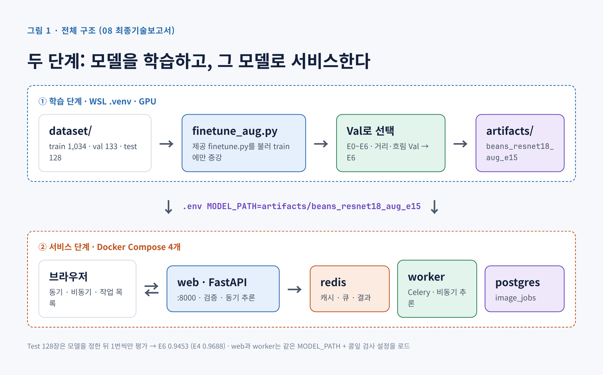

## 2. 모델 학습 결과 요약

| 항목 | 기준선 E0 | E4 Full (이전 서빙) | **E6 Full + 증강 (서빙)** |
|---|---|---|---|
| 학습 방식 | Head-only (Backbone 고정) | Full Fine-tuning (전체 학습) | Full + train 증강 (거리·회전·빛·흐림·화질) |
| 설정 | 3 epoch, lr 2e-4, batch 8 | 8 epoch, lr 5e-5, batch 8 | 15 epoch, lr 5e-5, batch 8 |
| Train / Validation / Test 수 | 1,034 / 133 / 128 | 같음 | 같음 |
| Best Validation Accuracy | 0.7669 (102/133) | 0.9925 (132/133) | **1.0000 (133/133)** |
| 재현성 | — | 같은 설정 4회 실행 모두 0.9925 | 1회 실행 |
| 멀리서 찍은 Val (60% 크기) | — | 0.5564 | **0.9925** |
| 외부 콩잎 사진 6장 | — | 4/6 | **6/6** |
| Test Accuracy (모델 확정 후 1회) | 미측정 | **0.9688 (124/128)** | 0.9453 (121/128) |
| Test + R1 보류 (시스템) | — | 보류 13.3%, 나머지 0.991 | 보류 11.7%, 나머지 **1.000** |
| 모델 파일 | `beans_resnet18/model.safetensors` | `beans_resnet18_full_e8/model.safetensors` | `beans_resnet18_aug_e15/model.safetensors` |

- 학습 코드 `training/finetune.py`는 수정하지 않았다. 실행 옵션(`--freeze-backbone` 유무, `--epochs`, `--lr`)만 바꿨고, 실험마다 출력 폴더를 따로 썼다. E6는 원본을 불러 쓰는 `training/finetune_aug.py`로 train 이미지에만 증강을 켰다
- E6로 바꾼 이유: 외부 사진처럼 거리·구도·화질이 바뀌면 E4가 무너졌다 (멀리 40% 크기에서 정확도 0.384인데 평균 확신도 0.957). 모델 교체는 Test를 보기 전에 정했고, 원본 Test에서는 E4가 3장 더 맞힌 결과도 그대로 보고한다
- 데이터: 원본 분할을 그대로 사용했다(`validation` → `val` 이름만 변경). md5 완전 중복 0건, macOS `.DS_Store` 1개 삭제
- 근거 문서: [산출물 1](01_FineTuning_결과보고서.md) · 원본 기록: `artifacts/*/training_report.json`

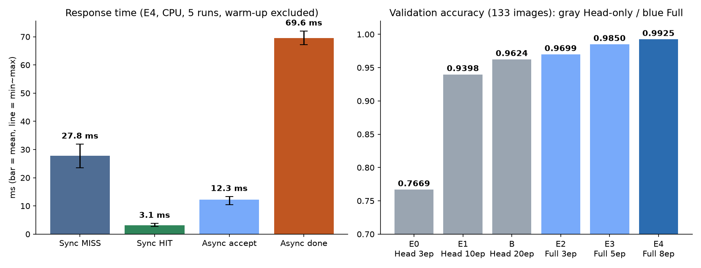

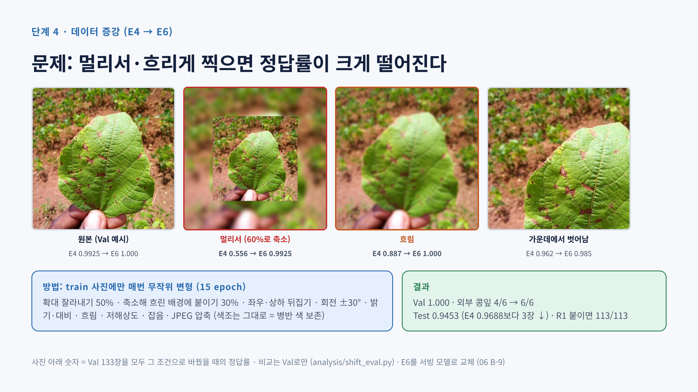

## 3. 아키텍처 및 데이터 흐름

- 동기: 브라우저 → FastAPI → Redis 캐시 (HIT면 바로 반환 / MISS면 ResNet18 추론 후 캐시 저장) → JSON 응답
- 비동기: 브라우저 → FastAPI (검증·파일 저장·DB `queued`) → Redis 브로커 → Celery Worker (`running` → 캐시/ResNet18 → `done`) → 브라우저가 상태 조회
- Redis 역할 분리: DB/1 캐시 · DB/2 브로커 · DB/3 결과 백엔드. 캐시 키 = 모델 경로 해시 + 이미지 sha256
- ResNet18은 web과 worker 프로세스에 **각각** 올라간다 (첫 요청에 약 2.1~2.9초 걸림)
- 근거 문서: [산출물 2](02_시스템_아키텍처.md)

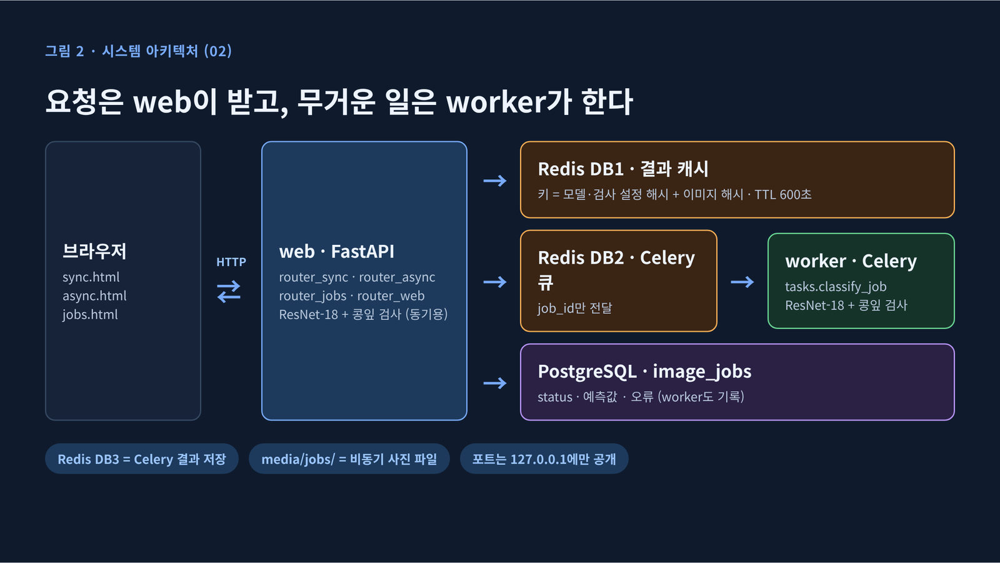

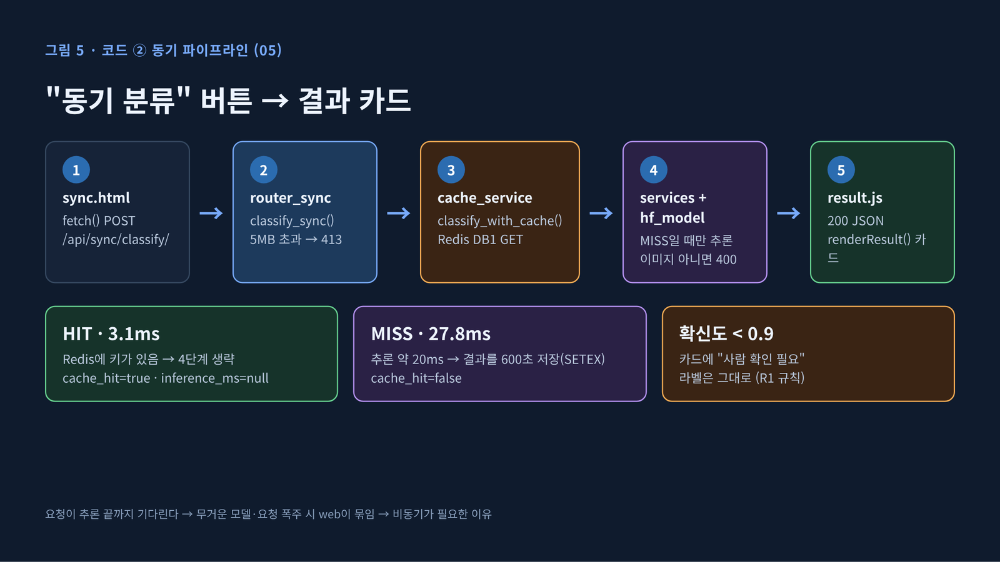

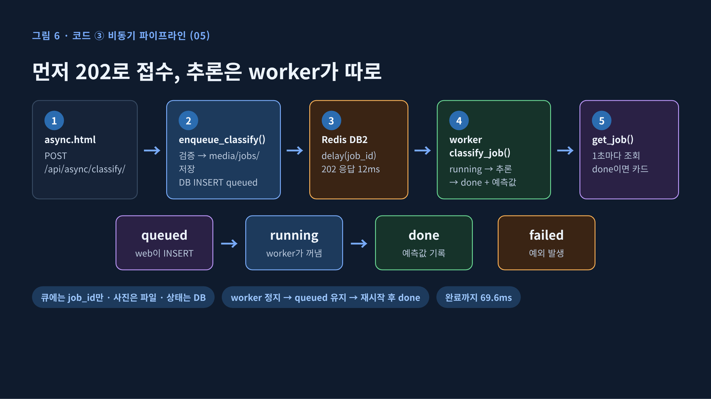

## 4. API·DB 설계

- 핵심 API: `GET /health`, `POST /api/sync/classify/` (200), `POST /api/async/classify/` (202), `GET /api/async/jobs/{job_id}/` (200/404)
- 추가 API: `GET /api/async/jobs/?limit=` (작업 목록), 화면 `/vision/jobs/`
- DB: PostgreSQL `image_jobs` 테이블 1개 (14개 컬럼 = 제공 12 + 콩잎 검사 2, FK 없음). 비동기 작업만 저장
- 추가 응답 필드: `leaf_check` (콩잎 아님 표시, 06 B-10)
- 근거 문서: [산출물 3](03_API_명세서.md) / [산출물 4](04_DB_구조_작업이력.md)

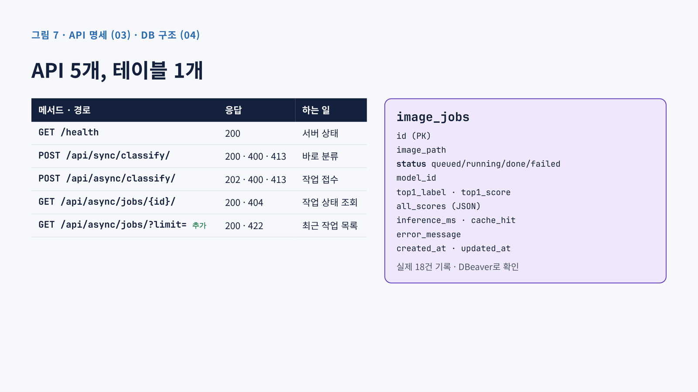

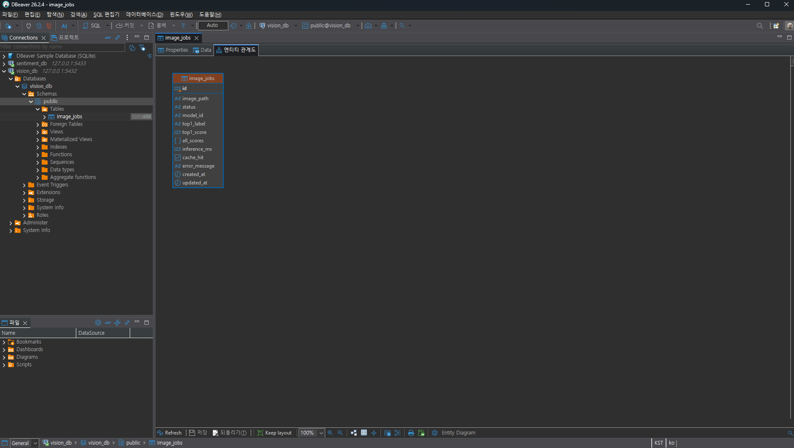

## 5. 실제 버튼 처리 검증

- 동기식: "동기 분류" 클릭 → 추론이 끝난 뒤 응답 → 결과 카드 표시 (예: healthy_test.8.jpg → 정상 99.6%)
- 비동기식: "Celery 작업 등록" 클릭 → 202와 job_id 수신 → 1초 간격으로 상태 조회 → `done`이면 결과 카드 표시
- 작업 목록: DB의 최근 작업을 3초마다 갱신해 표로 표시
- 근거 문서: [산출물 5](05_AI버튼_처리흐름.md)

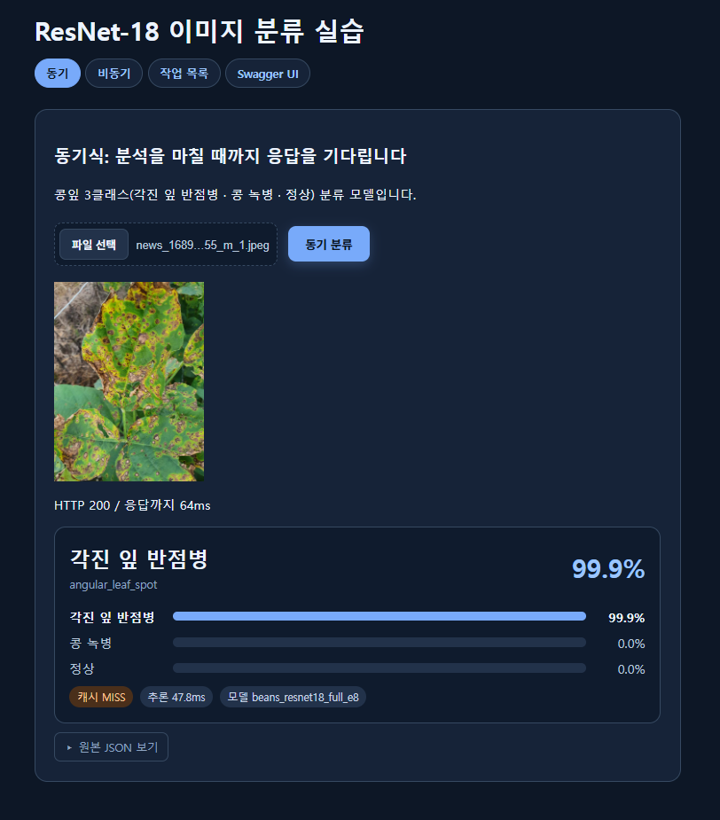
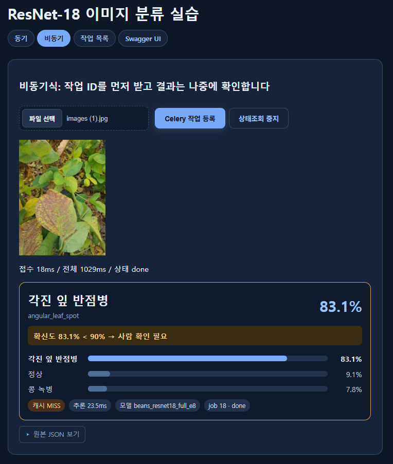
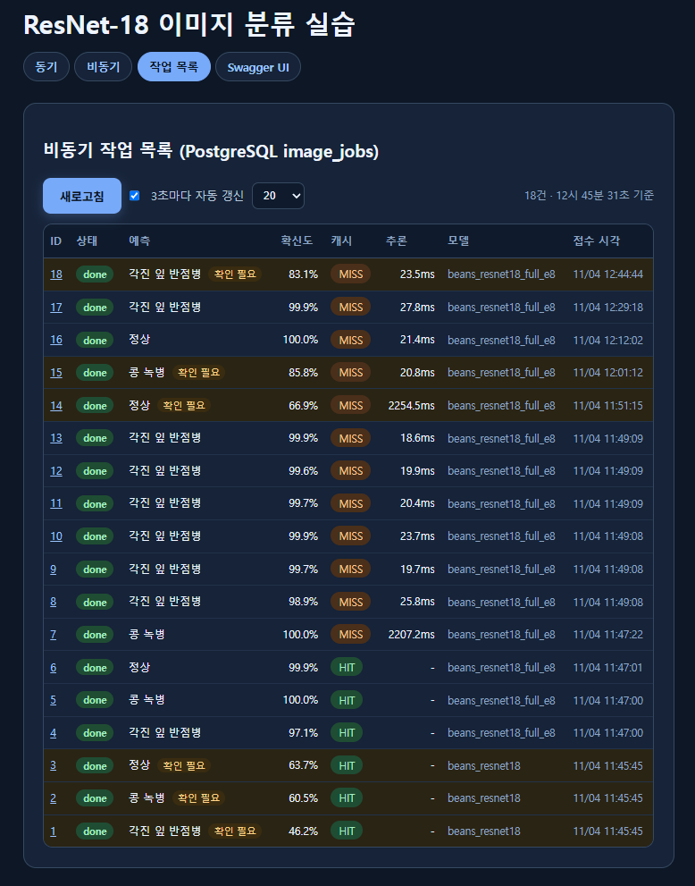

왼쪽부터 동기 결과 카드 · 비동기 접수와 상태 조회 · 작업 목록(0.9 미만은 "확인 필요")

## 6. 실제 성능 비교 (E4 서빙 당시 측정, CPU, 5회, warm-up 제외 · E6도 같은 ResNet-18 구조)

| 항목 | 평균 | 중앙값 |
|---|---:|---:|
| 동기 MISS 응답 완료 | 27.8ms | 27.4ms |
| 동기 HIT 응답 완료 | 3.1ms | 3.1ms |
| 비동기 MISS 접수 | 12.3ms | 12.3ms |
| 비동기 MISS 최종 확인 (폴링 포함) | 69.6ms | 69.6ms |

- 캐시: HIT가 MISS보다 약 89% 짧다 (추론 생략)
- 비동기: 접수는 동기보다 빠르지만 완료는 약 42ms 느리다 (큐 전달, DB 기록, 폴링 비용). **추론 자체가 빨라진 것은 아니다.** 접수와 처리를 분리해 웹 서버가 막히지 않는 효과가 있다
- 근거 문서: [산출물 6](06_성능비교_보고서.md) Part A · 원본 `data/timings.csv`

(그래프는 §2 그림 왼쪽 "Response time")

## 7. 기능 테스트·오류 조치

- 모의 테스트: `tests/test_api.py` 6 passed (콩잎 거리 검사 2개 추가)
- 실환경 테스트: 16개 PASS (헬스, 동기, 비동기 접수·완료, Redis, DB, 불량 입력 400, 없는 job 404, 캐시 MISS→HIT, Worker 정지 시 queued → 재시작 후 done, PostgreSQL 준비, 추가 기능 3개, 서빙 모델 E6 교체, 콩잎 아님 표시). 한계 확인 1개: 외부 사진(T-17). 미실시 2개: 5MB 초과, Redis 정지
- 실제 오류와 조치 9건 (E-09: `.env` 줄바꿈 누락으로 설정 줄이 붙음). 대표 사례: `.env`가 기준선 경로로 덮어써져 E0로 서빙됨 → 경로 수정 후 컨테이너 재생성. DB에 남은 job 1~3(E0)은 기록으로 보존했다
- 근거 문서: [산출물 7](07_기능테스트_오류분석.md)

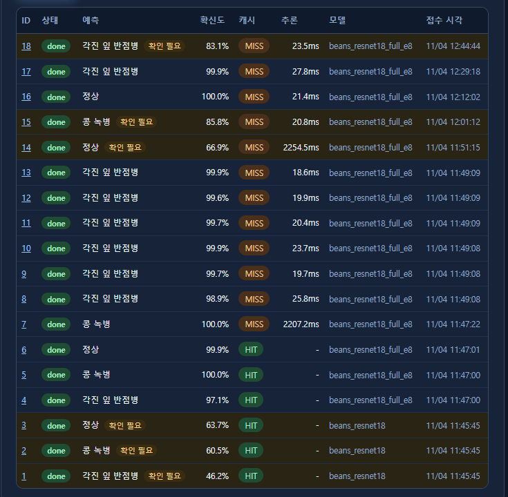

job 1~3이 `beans_resnet18`(기준선)으로 서빙된 기록. DB의 `model_id`로 `.env` 덮어쓰기를 찾았다

## 8. 성능 향상 실험 (평가가이드 6장, 권장 순서 ①→⑤)

| 단계 | 구현 | 결과 |
|---|---|---|
| ① Head-only 기준선 | 실행 | Val 0.7669 · 20 epoch까지 늘려도 0.9624가 한계 |
| ② Full Fine-tuning | 실행 | Val **0.9925**, 기준선보다 22.6%p 상승 |
| ③ HSV·GrabCut·Contour 원인 분석 | **구현·측정** | 반점 면적비 중앙값: 정상 0.0008, 병든 잎 0.016~0.032 (Train). 분포 끝은 겹침 |
| ④ 규칙 기반 보류 | **구현·측정** | R1(확신도 < 0.9): Test 13.3% 보류, 나머지 **0.991** · HSV 규칙 R2는 효과 없음 |
| 앙상블·TTA | 구현·측정 | Val 차이 없음 → 채택 안 함 (ENS4 Test 0.9844는 보조 결과로만 보고) |
| 데이터 증강 (E6) | **구현·측정 → 서빙 채택** | 멀리서 찍은 Val 0.556 → 0.992, 흐림 0.887 → 1.000, 외부 콩잎 4/6 → 6/6 · 원본 Test 0.9688 → 0.9453 |
| 콩잎 아님 표시 (정규분포 거리, 7일차 방식) | **구현·서빙 연결** | ImageNet 특징 거리 > 27.65: 고양이·토마토·곤충 사진 검출, 새로 잘못 걸린 콩잎 0장 (외부 14장) · 다른 식물 잎은 못 거름 |
| E4+E6 앙상블 | 구현·측정 → 미채택 | 멀리서 찍은 Val 0.992 → 0.857로 하락 |
| Grad-CAM 판정 근거 확인 | **구현·측정** | Test 보류 15장: 근거가 대부분 잎의 반점 위. 병끼리 틀린 사진도 같은 잎을 봄 (06 B-11) |
| ⑤ ML 융합·배경 제거 입력 | **[제안 / 미구현]** | Val 오답 1장이라 효과를 잴 수 없음, 시간 부족 |

- 모델 단독 성능(E4 Test 0.9688, E6 0.9453)과 보류 규칙을 붙인 시스템 성능(E4 0.991, E6 1.000)을 **따로** 보고한다
- R1 기준값 0.9와 HSV v2 범위는 Val을 보고 정했다 (공개). Test는 E4·E6 각각 모델을 정한 뒤 1번씩만 사용했다
- 서비스 반영: 확신도 90% 미만이면 결과 카드와 작업 목록에 "사람 확인 필요"로 표시한다 (예측 라벨은 바꾸지 않음). 인터넷 사진 확인(06 B-6) 후 카드 문구에 "병명이 불확실하거나 콩잎 사진이 아닐 수 있어요"를 덧붙였다
- 근거 문서: [산출물 6](06_성능비교_보고서.md) Part B · 코드 `analysis/`

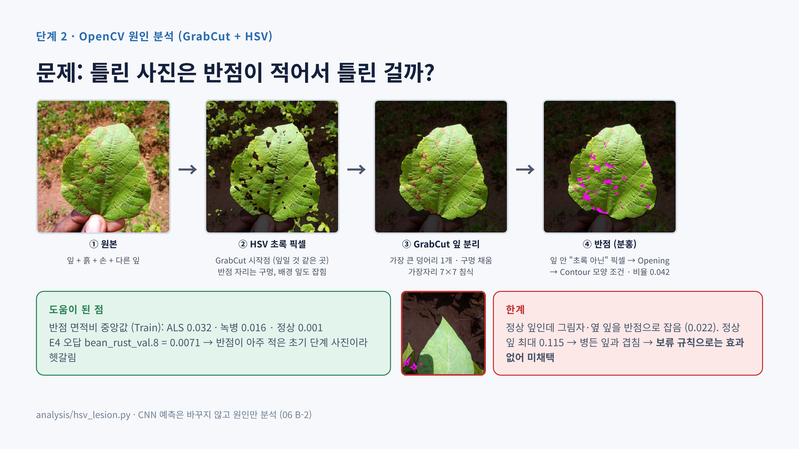

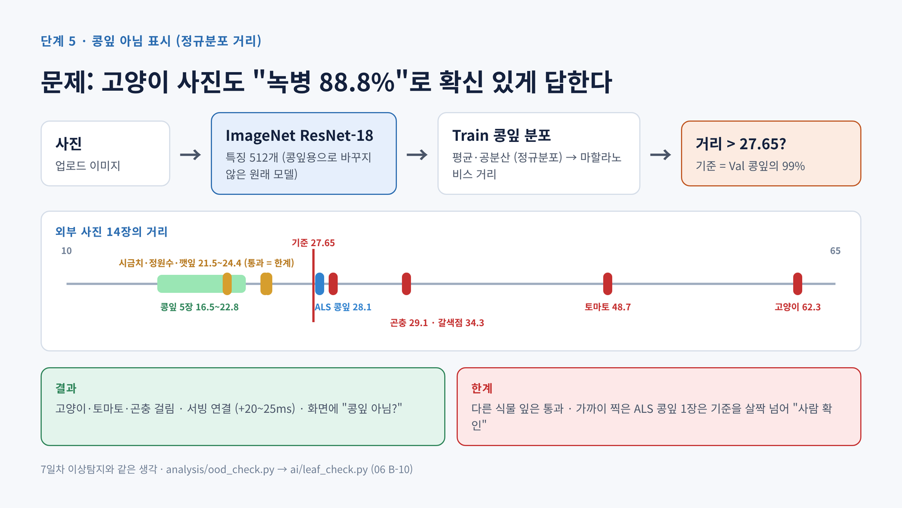

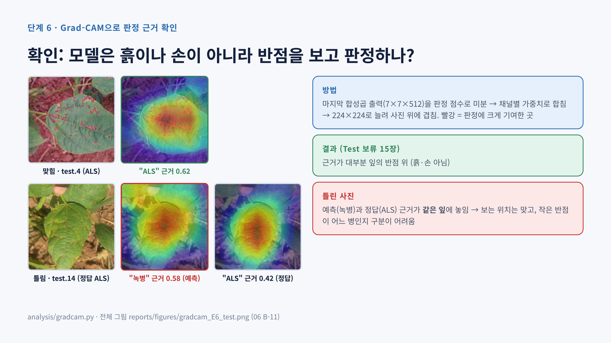

## 9. 최종 판정 및 한계

- **필수 기능**: Head-only 학습·모델 저장·동기 API · Redis·PostgreSQL·Celery 비동기 접수/조회 · 캐시 HIT/MISS · DB 기록 · 응답시간 비교 · 8개 산출물 + README를 모두 실행하고 증빙했다
- **선택 실험**: Full Fine-tuning으로 Val 0.7669 → 0.9925, Test 0.9688 (E4). 데이터 증강(E6)으로 거리·흐림 변화와 외부 콩잎 사진에 강해져 서빙 모델로 교체 (Test 0.9453, R1 보류 제외 1.000)
- **모델 분류 품질**: E4 Test 오답 4장은 모두 bean_rust였다 (반점이 적은 초기 녹병 잎이 약점). E6 Test 오답 7장은 세 클래스에 퍼져 있고 모두 확신도 0.9 미만이라 보류된다
- **한계**
  - Val 133장에서 1장 = 0.75%p라서 상위 설정끼리 비교하기 어렵다 (천장 효과)
  - near-duplicate는 점검하지 않았고, 현장 촬영 사진으로는 검증하지 않았다. 증강 효과는 변형한 Val과 인터넷 사진 14장으로만 확인했다
  - E6는 원본 Beans Test에서 E4보다 3장 적게 맞히고, 외부 녹병 사진 확신도가 0.340으로 낮다 (보류로 넘어감)
  - E6는 콩잎이 아닌 초록 잎(시금치·정원수)을 healthy 0.99로 답하고, 거리 검사로도 걸러지지 않는다 (06 B-9·B-10). 잎이 아닌 물체(고양이·토마토)는 거리 검사로 표시한다
  - (E4 기준) "모름" 클래스가 없어 콩잎이 아닌 사진(고양이·토마토·곤충)도 bean_rust로 답한다. 다른 잎(정원수·시금치·깻잎)·토마토·고양이 5장은 R1 보류(0.9 미만)로 걸렀지만, 곤충이 올라간 콩잎은 녹병 0.995로 높게 확신해 걸러지지 않았다. 곤충을 지워도 0.996이라 곤충이 아니라 잎 자체를 근거로 판단했다 (06 B-6·B-6-1, 인터넷 사진 9장)
  - 서빙은 CPU에서 하고, 동시 요청 부하는 측정하지 않았다
  - 컨테이너가 root로 실행되고, DB 비밀번호는 실습용 기본값이다 (포트는 127.0.0.1에만 공개)
- **추후 과제**: 콩잎 아닌 잎 사진을 모아 "기타" 클래스 학습, Test 콩잎으로 거리 검사 오탐률 측정, 녹병 초기 사진 보강, Train 교차검증 기반 CNN + HSV 특징 ML 융합, 동시 요청 부하 테스트

![남은 한계와 개선 방향 [제안 / 미구현]](figures/08/11_남은한계.png)
